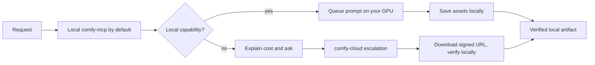

# Comfy Design

## Plugin marketplaces

This plugin belongs to **AIGC content creation**.

| Category | Marketplace | Purpose |
| --- | --- | --- |
| Full-stack development | [Full Stack Plugins](https://github.com/partme-ai/full-stack-plugins) | Architecture and UI design, code understanding, quality checks, code review, workflow governance, and server operations |
| AIGC content creation | [Full AIGC Plugins](https://github.com/partme-ai/full-aigc-plugins) | Image, video, audio, music, 3D, and multimodal content creation |


> Generate images, video, audio and 3D on your own GPU through a local ComfyUI MCP, and escalate to Comfy Cloud only for partner models, registry search and uploads.

[](https://github.com/full-aigc-plugins/comfy-design-plugin/releases) [](#skills) [](#mcp-tools) [](LICENSE)

[English](README.md) | [简体中文](README.zh-CN.md) · [Install](#installation) · [Quick start](#quick-start) · [Skills](#skills) · [MCP tools](#mcp-tools) · [Troubleshooting](#troubleshooting)

## Positioning

`comfy-design` connects a coding agent to **a ComfyUI instance you run yourself**. Local generation is free, prompts and artifacts stay on your machine, and the hosted Comfy MCP is an opt-in escalation for the cloud-only surface. The plugin never starts ComfyUI for you, never silently switches to a paid path, and never retries a submission whose result is unknown.

The content bodies are vendored from `Comfy-Org/comfy-skills` (MIT) and the local MCP server from `MetaBrain-Labs/ComfyUI-MCP-Server-Python` (MIT) with documented patches. Vendored text is unmodified; only host packaging is added.

## Installation

### Prerequisites

- Python 3.10 or newer for the vendored MCP runtime.
- A running ComfyUI service, by default at `127.0.0.1:8188`. A LAN host is supported through `COMFY_UI_SERVER_IP`/`HOST`/`PORT` in `vendor/comfyui-mcp-server/.env`.
- Optional: a `comfyui-` prefixed Comfy Cloud API key, only for the cloud escalation path.
- A GPU with enough VRAM for the models you intend to run; model files are not bundled.

### One-time local setup

```bash
python3 scripts/setup_comfy_mcp.py        # create the vendored venv and install locked deps
python3 scripts/comfy_local_setup.py check # read-only status: venv, target reachability, cloud key
```

The host actually launches `scripts/comfy_mcp_bootstrap.py`, which preflights the venv, generates `.env` on first use, checks that the target ComfyUI answers, and only then hands stdio to the vendored server.

### From the plugin marketplace

```bash
codex plugin marketplace add partme-ai/full-aigc-plugins
codex plugin add comfy-design@full-aigc-plugins
```

Restart the host and open a new task. If the local server cannot start, the bootstrap prints one actionable diagnostic instead of `command not found`.

## Quick start



```text
Generate an image of a ceramic teapot on a linen table with soft morning light,
using my local ComfyUI. Show the workflow you picked and save the result to my output folder.
```

Expected observation: `get_system_status` confirms the service and VRAM, the workflow is queued locally, and the artifact lands in the directory you named. No credits are consumed.

## What you can build

| Workflow | Built-in path | Verifiable output |
| --- | --- | --- |
| Text-to-image and edits | `comfy-generate-image`, `comfy-design-loop` | Local image files plus the workflow used |
| Video generation | `comfy-generate-video` | Local video artifact |
| Audio and 3D | `comfy-generate-audio`, `comfy-generate-3d` | Local audio or mesh artifact |
| Utility passes | `comfy-upscale-image`, `comfy-remove-background`, `technique-combine-people` | Processed image files |
| Discover what is installed | `comfy-search-models`, `comfy-search-nodes`, `comfy-search-templates`, `comfy-help` | Model, node and workflow inventories |

## Skills

| Skill | What it does |
| --- | --- |
| `comfy-generate-image` | Generates, edits or modifies an image through Comfy. |
| `comfy-generate-video` | Generates, edits or extends a video through Comfy. |
| `comfy-generate-audio` | Generates speech or sound effects through Comfy. |
| `comfy-generate-3d` | Generates a 3D model through Comfy. |
| `comfy-upscale-image` | Upscales an image. |
| `comfy-remove-background` | Removes an image background. |
| `technique-combine-people` | Composites the user's photo with another person into one image. |
| `comfy-search-models` | Searches available models. |
| `comfy-search-nodes` | Searches nodes with wiring hints. |
| `comfy-search-templates` | Finds pre-built workflow templates. |
| `comfy-help` | Explains what the Comfy tool surface can do. |
| `comfy-local-setup` | Configures the target host, the optional cloud key and the local runtime. |
| `comfy-harness` | Invocation spec: local-first routing, cloud-to-local tool mapping, cost gates and submit-once. |
| `comfy-design-loop` | Multi-round quality loop against an anchored target image with an independent rubric review. |

## Slash commands

| Command | What it does |
| --- | --- |
| `/comfy-generate-image` | Generate, edit or modify an image. |
| `/comfy-generate-video` | Generate, edit or extend a video. |
| `/comfy-generate-audio` | Generate audio. |
| `/comfy-generate-3d` | Generate a 3D model. |
| `/comfy-upscale-image` | Upscale an image. |
| `/comfy-remove-background` | Remove an image background. |
| `/comfy-combine-people` | Composite multiple people into one image. |
| `/comfy-search-models` | Search the model catalog. |
| `/comfy-search-nodes` | Search nodes with wiring hints. |
| `/comfy-search-templates` | Find workflow templates. |
| `/comfy-help` | Show what the tool surface can do. |
| `/comfy-local-setup` | Configure the target host, cloud key and runtime self-check. |

## MCP tools

`mcp.json` declares two servers: `comfy-mcp` (stdio, your machine, **default**) and `comfy-cloud` (hosted HTTPS, **escalation only**).

| Server | Real tools (selection) | Notes |
| --- | --- | --- |
| `comfy-mcp` | `get_system_status`, `list_models`, `get_workflows_catalog`, `mount_workflow`, `queue_prompt`, `get_prompt_result`, `save_task_assets`, `interrupt_prompt` | 17 local tools in total, including `queue_custom_prompt`, `save_custom_workflow`, `upload_assets`, `free_memory` and `list_local_templates` |
| `comfy-cloud` | `search_models`, `search_nodes`, `search_templates`, `submit_workflow`, `get_job_status`, `get_output`, `upload_file`, `run_template`, `partner_generate` | Requires a `comfyui-` API key or OAuth; generation is billed |

Local generation writes files directly. The cloud path returns a signed URL and a ready-to-run `curl`; execute it verbatim, then verify the downloaded file locally.

## Configuration

| Setting | Location | Notes |
| --- | --- | --- |
| ComfyUI target | `vendor/comfyui-mcp-server/.env` | `COMFY_UI_SERVER_IP`/`HOST`/`PORT`, default `127.0.0.1:8188` |
| Local setup form | `python3 scripts/comfy_local_setup.py ui` | `http://127.0.0.1:8192`; writes the target and a restricted user config |
| Cloud API key | Host secret store or `COMFY_API_KEY` | Optional; never commit it and never paste it into chat |
| Vendored venv | `vendor/comfyui-mcp-server/.venv` | Created by `scripts/setup_comfy_mcp.py` |

## Architecture and security

The plugin owns host adapters, configuration injection, scripts and its two local Skills. ComfyUI owns rendering; Comfy-Org owns the vendored content; the authors receive no prompt or artifact.

- The default path is local, so prompts and outputs leave neither the machine nor the LAN target you configured.
- The optional HTTP transport has **no authentication** and binds `127.0.0.1` only; exposing it requires your own authenticated gateway.
- Cloud escalation is announced with its cost before it happens; named partner models exist only in the cloud.
- A submitted `prompt_id` is persisted before polling. Unknown or failed results are reported, never automatically resubmitted.

## Troubleshooting

| Symptom | Check first | Resolution |
| --- | --- | --- |
| Local MCP does not start | Bootstrap stderr preflight | Missing venv → `python3 scripts/setup_comfy_mcp.py` |
| Target unreachable | ComfyUI process and `.env` | Start ComfyUI first; the plugin will not launch it |
| A named model is refused locally | Local model inventory | That model is cloud partner-only; approve the escalation or pick a local model |
| Cloud calls fail | API key and subscription | Use `codex mcp login comfy-cloud` or a `comfyui-` key with credits |
| Workflow catalog is empty | Background scan still running | Wait, or submit API JSON through `queue_custom_prompt` |
| A long job blocks | Sync/async choice | Short jobs stay synchronous; video and upscale need `is_async: "true"` |

## Upgrade

```bash
codex plugin marketplace upgrade full-aigc-plugins
codex plugin add comfy-design@full-aigc-plugins
```

After upgrading, re-run `python3 scripts/comfy_local_setup.py check` and the vendored skill check, because the pinned upstream revision and the MCP patch set are versioned with the plugin.

Current packaged version: `0.6.1+codex.20261018` (development preview).

## Contributing and support

Open functional issues at <https://github.com/full-aigc-plugins/comfy-design-plugin/issues>. State the ComfyUI version, the target host shape (local or LAN) and whether the change touches the vendored server or only the adapter. Do not edit vendored bodies directly.

## License

Apache-2.0 for the adapter code. Vendored skill and command content is MIT from Comfy-Org — see [NOTICE](NOTICE), `upstream/comfy-skills.lock.json` and `vendor/comfyui-mcp-server/PATCHES.md`.
