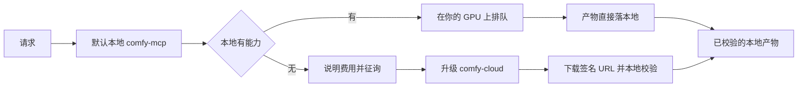

# Comfy Design

## 插件市场导航

本插件所属分类：**AIGC 内容创作**。

| 分类 | 插件市场入口 | 用途 |
| --- | --- | --- |
| 全栈开发 | [Full Stack Plugins](https://github.com/partme-ai/full-stack-plugins) | 架构与 UI 设计、代码理解、质量检查、代码审查、流程治理与服务器运维 |
| AIGC 内容创作 | [Full AIGC Plugins](https://github.com/partme-ai/full-aigc-plugins) | 图像、视频、音频、音乐、3D 与多模态内容创作 |


> 通过本地 ComfyUI MCP 在自己的 GPU 上生成图像、视频、音频与 3D；只有伙伴模型、注册表检索和上传才升级到 Comfy Cloud。

[](https://github.com/full-aigc-plugins/comfy-design-plugin/releases) [](#技能) [](#mcp-工具) [](LICENSE)

[English](README.md) | [简体中文](README.zh-CN.md) · [安装](#安装) · [快速开始](#快速开始) · [技能](#技能) · [MCP 工具](#mcp-工具) · [故障排查](#故障排查)

## 项目定位

`comfy-design` 把编码智能体连接到**你自己运行的 ComfyUI**。本地生成不花积分，提示词与产物不出本机；托管的 Comfy MCP 只作为云端独有能力的显式升级路径。插件不会替你启动 ComfyUI，不会静默切到付费通道，也不会对结果不明的提交自动重试。

技能与命令正文来自 `Comfy-Org/comfy-skills`（MIT）的 vendor 快照，本地 MCP server 来自 `MetaBrain-Labs/ComfyUI-MCP-Server-Python`（MIT），并附带已记录的补丁。vendor 正文逐字保留，仓库只增加宿主适配包装。

## 安装

### 前置条件

- 内置 MCP 运行时需要 Python 3.10 或更新版本。
- 一个正在运行的 ComfyUI 服务，默认 `127.0.0.1:8188`；可把 `vendor/comfyui-mcp-server/.env` 中的 `COMFY_UI_SERVER_IP`/`HOST`/`PORT` 指向局域网主机。
- 可选：`comfyui-` 前缀的 Comfy Cloud API Key，仅云端升级路径需要。
- 显存足够运行目标模型；模型文件不由插件提供。

### 一次性本地初始化

```bash
python3 scripts/setup_comfy_mcp.py        # 创建 vendored venv 并安装锁定依赖
python3 scripts/comfy_local_setup.py check # 只读状态：venv、目标可达性、云端 Key
```

宿主实际拉起的是 `scripts/comfy_mcp_bootstrap.py`：它先做 venv 预检、首次生成 `.env`、确认目标 ComfyUI 可达，全部就绪后才把 stdio 交给 vendored server。

### 从插件市场安装

```bash
codex plugin marketplace add partme-ai/full-aigc-plugins
codex plugin add comfy-design@full-aigc-plugins
```

重启宿主并新建任务。如果本地 server 起不来，bootstrap 会给出一条可操作的诊断，而不是 `command not found`。

## 快速开始



```text
用我的本地 ComfyUI 生成一张图：亚麻桌布上的哑光陶瓷茶壶，清晨柔光。
告诉我你选了哪个工作流，并把结果保存到我的输出目录。
```

预期现象：`get_system_status` 确认服务与显存，工作流在本地排队，产物落到你指定的目录，不消耗任何积分。

## 可完成的工作

| 工作流 | 内置路径 | 可验证输出 |
| --- | --- | --- |
| 文生图与编辑 | `comfy-generate-image`、`comfy-design-loop` | 本地图像文件与实际使用的工作流 |
| 视频生成 | `comfy-generate-video` | 本地视频文件 |
| 音频与 3D | `comfy-generate-audio`、`comfy-generate-3d` | 本地音频或模型文件 |
| 工具型处理 | `comfy-upscale-image`、`comfy-remove-background`、`technique-combine-people` | 处理后的图像文件 |
| 盘点已装资源 | `comfy-search-models`、`comfy-search-nodes`、`comfy-search-templates`、`comfy-help` | 模型、节点与工作流清单 |

## 技能

| 技能 | 作用 |
| --- | --- |
| `comfy-generate-image` | 通过 Comfy 生成、编辑或修改图像。 |
| `comfy-generate-video` | 通过 Comfy 生成、编辑或延长视频。 |
| `comfy-generate-audio` | 通过 Comfy 生成语音或音效。 |
| `comfy-generate-3d` | 通过 Comfy 生成 3D 模型。 |
| `comfy-upscale-image` | 放大图像。 |
| `comfy-remove-background` | 去除图像背景。 |
| `technique-combine-people` | 把用户照片与另一个人合成到同一张图。 |
| `comfy-search-models` | 搜索可用模型。 |
| `comfy-search-nodes` | 搜索节点并给出连线提示。 |
| `comfy-search-templates` | 查找预置工作流模板。 |
| `comfy-help` | 说明 Comfy 工具面能做什么。 |
| `comfy-local-setup` | 配置目标主机、可选云端 Key 与本地运行环境。 |
| `comfy-harness` | 调用规范：本地优先路由、云端到本地工具映射、成本门禁与一次提交。 |
| `comfy-design-loop` | 锚定目标图的多轮质量循环，由独立评审按 rubric 收敛。 |

## 斜杠命令

| 命令 | 作用 |
| --- | --- |
| `/comfy-generate-image` | 生成、编辑或修改图像。 |
| `/comfy-generate-video` | 生成、编辑或延长视频。 |
| `/comfy-generate-audio` | 生成音频。 |
| `/comfy-generate-3d` | 生成 3D 模型。 |
| `/comfy-upscale-image` | 放大图像。 |
| `/comfy-remove-background` | 去除图像背景。 |
| `/comfy-combine-people` | 把多个人物合成到一张图。 |
| `/comfy-search-models` | 搜索模型目录。 |
| `/comfy-search-nodes` | 搜索节点并给出连线提示。 |
| `/comfy-search-templates` | 查找工作流模板。 |
| `/comfy-help` | 展示工具面能力。 |
| `/comfy-local-setup` | 配置目标主机、云端 Key 与运行环境自检。 |

## MCP 工具

`mcp.json` 声明两个 server：`comfy-mcp`（stdio，跑在本机，**默认**）与 `comfy-cloud`（托管 HTTPS，**仅升级**）。

| Server | 真实工具（节选） | 说明 |
| --- | --- | --- |
| `comfy-mcp` | `get_system_status`、`list_models`、`get_workflows_catalog`、`mount_workflow`、`queue_prompt`、`get_prompt_result`、`save_task_assets`、`interrupt_prompt` | 本地共 17 个工具，含 `queue_custom_prompt`、`save_custom_workflow`、`upload_assets`、`free_memory`、`list_local_templates` 等 |
| `comfy-cloud` | `search_models`、`search_nodes`、`search_templates`、`submit_workflow`、`get_job_status`、`get_output`、`upload_file`、`run_template`、`partner_generate` | 需要 `comfyui-` Key 或 OAuth；生成计费 |

本地路径直接写文件。云端路径返回签名 URL 与可直接执行的 `curl`，需原样执行，再在本地校验下载结果。

## 配置

| 设置 | 位置 | 说明 |
| --- | --- | --- |
| ComfyUI 目标 | `vendor/comfyui-mcp-server/.env` | `COMFY_UI_SERVER_IP`/`HOST`/`PORT`，默认 `127.0.0.1:8188` |
| 本地配置页 | `python3 scripts/comfy_local_setup.py ui` | `http://127.0.0.1:8192`，写入目标主机与受限用户配置 |
| 云端 API Key | 宿主密钥存储或 `COMFY_API_KEY` | 可选；不要提交进仓库，也不要粘进聊天 |
| vendored venv | `vendor/comfyui-mcp-server/.venv` | 由 `scripts/setup_comfy_mcp.py` 创建 |

## 架构与安全

插件负责宿主适配、配置注入、脚本与两个插件本地技能。ComfyUI 负责渲染，Comfy-Org 负责 vendor 正文，作者不接收任何提示词或产物。

- 默认走本地，提示词与产物既不离开本机，也不离开你配置的局域网目标。
- 可选 HTTP 传输**没有鉴权**且只绑 `127.0.0.1`；对外暴露必须自行加带鉴权的网关。
- 云端升级会先说明费用并征得同意；具名伙伴模型只在云端提供。
- 提交后先持久化 `prompt_id` 再轮询；结果未知或失败会如实上报，绝不自动重新提交。

## 故障排查

| 现象 | 先检查 | 处理 |
| --- | --- | --- |
| 本地 MCP 起不来 | bootstrap 的 stderr 预检 | venv 缺失 → `python3 scripts/setup_comfy_mcp.py` |
| 目标不可达 | ComfyUI 进程与 `.env` | 先启动 ComfyUI；插件不会代你拉起 |
| 具名模型在本地被拒 | 本地模型清单 | 该模型仅云端伙伴提供，确认升级或改用本地模型 |
| 云端调用失败 | API Key 与订阅 | 使用 `codex mcp login comfy-cloud`，或带积分的 `comfyui-` Key |
| 工作流目录为空 | 后台扫描是否完成 | 稍等，或用 `queue_custom_prompt` 直接提交 API JSON |
| 长任务卡住 | 同步/异步选择 | 短任务保持同步；视频与放大需设 `is_async: "true"` |

## 升级

```bash
codex plugin marketplace upgrade full-aigc-plugins
codex plugin add comfy-design@full-aigc-plugins
```

升级后重新运行 `python3 scripts/comfy_local_setup.py check` 与 vendor 技能校验，因为钉住的上游修订与 MCP 补丁集随插件版本变化。

当前打包版本：`0.6.1+codex.20261018`（开发预览）。

## 贡献与支持

功能问题请提交到 <https://github.com/full-aigc-plugins/comfy-design-plugin/issues>。说明 ComfyUI 版本、目标主机形态（本机或局域网）以及改动只涉及适配层还是触及 vendored server。不要直接修改 vendor 正文。

## 许可证

适配层代码为 Apache-2.0。vendor 的技能与命令正文为 Comfy-Org 的 MIT 许可，详见 [NOTICE](NOTICE)、`upstream/comfy-skills.lock.json` 与 `vendor/comfyui-mcp-server/PATCHES.md`。
